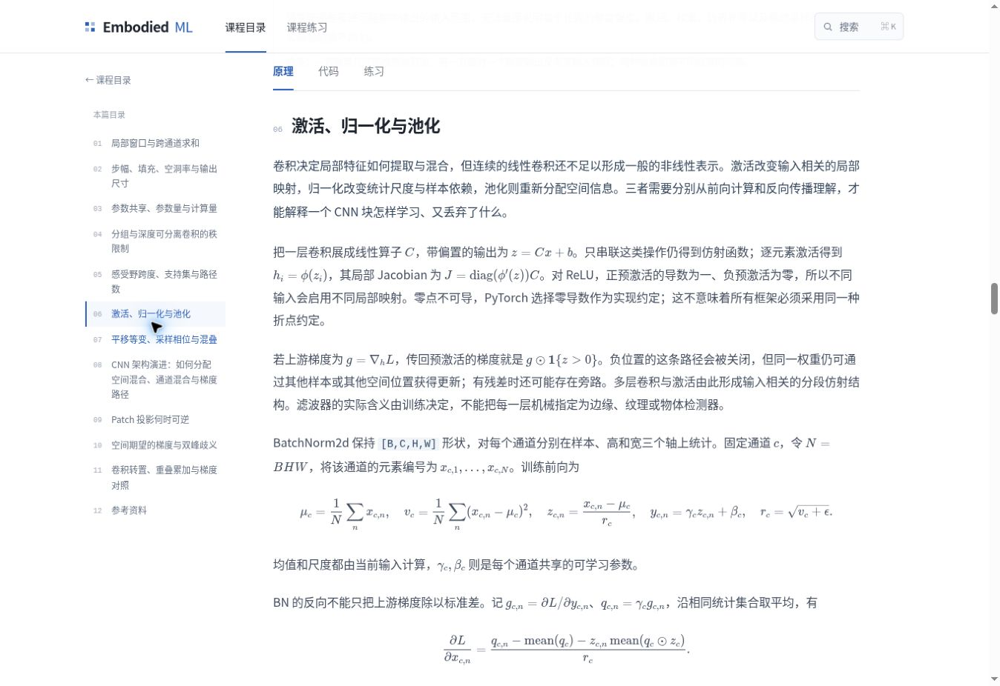

# Embodied ML Lab：全站教材质量优化交付报告

## 已完成的范围

本轮逐篇审查并实际修改了现有 **49 篇课程、425 个理论子节**。所有课程具备自然章节导言，所有理论子节具备独立撰写的总领段，已进入正常正文、搜索、静态 HTML 与下载讲义。共用四篇核心理论来源没有重复计数。本轮没有新增课程，也没有删除成熟课程；调整重点是教学顺序、推导的中间步骤、实现一致性与重复内容的归属。

“审查覆盖全站”不代表“所有正文均被重写”。逐篇状态见本报告末表与 [覆盖记录](textbook-quality-coverage.json)：深改、顺序调整、实现修正、仅改善导入并保留成熟正文分别记录。全部课程都有实际导入修改，没有只审查而未处理导入的课程。

## 发现的共性问题

1. 常规课程虽有目标和结论字段，实际文章开头缺少动机；多数子节直接进入公式或边界情况。
2. 一些进阶证明先于基本机制：MLP 的构造逼近、矩阵章的 SVD、FM 的弱连续性、BC 的 VLA 分类、DDPM 的变分界都需要更合适的出现位置。
3. 基础与进阶深度不均：CNN 的秩、支持集和路径数已充分，但激活、统计轴、池化反向只有概述。其他课程也存在中间步骤跳跃。
4. 原理页的结论清单、末尾问答和易错点与正文重复，打断长文阅读；有思考价值的问题应进入已有练习页。
5. 个别实现与正文约定不一致：无效 NaN 乘零仍污染损失或梯度；动作历史和执行长度复用符号；少数公式拆分或引用缺失。

## 目录与章节边界

保留现有两级、七模块目录，其显式前置依赖全部出现在相应课程之前：

| 模块 | 课程数 | 本轮组织决定 |
|---|---:|---|
| 数学与机器学习基础 | 8 | 基础求导先于 SVD，补齐似然与损失的桥接；优化器课明确展开 SGD 与 Momentum。 |
| 神经网络与表示学习 | 5 | MLP 先前向/反向，再表达能力；BN 前向统计先于导数；CNN 以基本算子、空间几何、优化与表示层层推进。 |
| Transformer 与多模态模型 | 9 | Attention 建立算子，Transformer 接入完整 Block 和多层信息流；已有 Norm/Softmax 推导通过正文链接复用。 |
| 生成模型与连续时间建模 | 4 | DDPM 先有可训练的噪声任务，FM 先有可采样路径，再进入分布演化证明。 |
| 模仿学习、策略模型与 VLA 后训练 | 8 | BC 先共同监督机制，再辨别 VLA 接口；部分观测先有状态混叠实例，再引入 belief。 |
| 数据处理与训练工程 | 11 | 保留模块状态、累积、精度、重计算和恢复内容；固定小批次诊断先于复杂定位。 |
| 策略执行、评估与泛化 | 4 | 把访问分布、执行时序、估计对象与指标解释串联起来。 |

CNN 没有按建议机械拆成四篇浅页：其 11 个内部标题已能区分卷积/感受野基础、网络结构与优化、Patch/空间表示和转置/实现验证。本轮将“激活、归一化与池化”放在采样混叠的进阶分析之前，保留成熟的秩与支持集推导。Transformer、FM 同样通过内部顺序解决层次问题。

课程路由、所有 section ID、题目索引和草稿键保持；只重排显示顺序。原问题链接现在定位到练习页，既有合并章节的显式 legacy 映射继续有效。

## 有实质信息增量的改写

### CNN、MLP、Residual / Normalization

CNN 补齐卷积后非线性与局部 Jacobian、ReLU 分段导数、BN 的 B/H/W 统计轴及均值/方差三条梯度路径、训练和评估的 running statistics 差别。池化分别分析平均权重、唯一最大值、重叠窗口的梯度累加、边界分母和采样相位；两个空间位置不同但均值相同的特征图，直接验证 GAP 的不可区分性。新增完整代码与 Autograd 对照，BN 输入梯度最大误差为本次执行测得的约 4.44e−16。

MLP 从具体前向和分量微分建立矩阵反向，再讲构造逼近；Normalization 先计算统计量再分析导数。Residual 已有完整单块/多层 Jacobian、条件界和受控实验，主要改善导入与缩放/门控的先后解释，未重复生成成熟内容。

### Attention 与 Transformer

Attention 补齐双线性匹配、点积方差展开、Softmax 商法则及 Value/分数两条梯度。Transformer 用明确的 B/T/D 维度写出两次残差的完整 Pre-LN 前向，说明 FFN 接收注意力更新后的表示。两层最小实验验证：即使共享投影和 Mask，后续层仍会因为上下文表示改变而重新计算注意力。因果与前缀可见性、间接泄漏、缓存条件和手写练习保留。

重复的 Softmax 商法则和 LayerNorm Jacobian 改用正文交叉引用；保留本处需要的矩阵反向与 Pre/Post-Norm 结论，避免删除定义后留下无法独立理解的公式。

### Diffusion、Flow Matching 与连续时间

DDPM 从噪声回归进入后验，再把完整轨迹密度的乘积、对数比、反向链分解和全期望逐步写到局部 KL。FM 从端点与线性路径进入条件平方风险，得到条件均值后才证明其保留概率质量变化，最后进入 ODE 与 Euler/Heun。原有二维条件多峰训练、解析 Gaussian 场、耦合分析、Reflow 和端点限制保留，未替换已有测量数据。

Score/SDE 通过随机小步的一阶与二阶矩解释生成元；VAE 补齐 Gaussian 后验的完成平方。重要推导均区分假设、精确恒等式与具体数值例子的范围。

### 后训练、数据与诊断

BC 解释为何 Gaussian 似然得到 MSE、条件风险为何得到均值，以及不可约误差来自哪里。LoRA 从迹微分得到因子梯度；数据采样推导目标分布、采样概率与 loss 权重实际形成的风险；评估从得分不等式反演 Wilson 区间。

动作归一化、Mask MSE 与池化练习改为危险算术前选择有效元素，并验证无效 NaN 的前向隔离和零梯度。Action Chunk 统一历史 O、预测 H、执行 K。训练诊断以固定小批次为先，结合可表示目标与冲突标签的对照，建立“观测—假设—下一实验”的推理过程。

## 页面与内容职责

- 原理页开头显示自然导言，再给前置链接；每个理论标题后有连贯引导，保留连续推导。
- 删除文章开头独立关键结论列表，移出文末重复讨论/FAQ。推导题与辨析题归入既有练习页，题干直接可读，参考解按需展开。
- 原理、代码、练习仍是三个视图；未新增速查平台、知识图谱、进度、徽章或 AI 问答。
- 全文搜索直接索引导言、正文、实现和题目；旧问题链接自动转向对应练习，导航与草稿兼容检查已通过。
- 统一导入段的颜色、行距和留白；保留单侧目录与移动端目录，长公式在可聚焦区域内滚动。
- 全部课程三个视图均有可读取正文的预渲染 HTML，包含 KaTeX MathML、canonical 和 sitemap；这不等于保证搜索引擎收录。

## 验证结果

| 检查 | 实际结果 |
|---|---|
| 导入与依赖 | 49/49 课程、425/425 子节；精确重复导入 0；前置依赖顺序错误 0 |
| 公式解析 | 4,622 处、2,459 个独立表达式；错误 0、游离数学候选 0 |
| 数学与 Markdown 渲染回归 | 17 项通过 |
| 完整演示与参考实现 | 175 项记录：174 通过、1 环境受限、0 失败 |
| 代码验证复用 | 167 项仅在源码哈希一致时沿用既有实跑结果；7 个变更完整用例重新执行 |
| 路由与渲染 | 246 项通过，含题目迁移、旧 section 链接与练习草稿 |
| 静态交付 | 155 个 HTML 页面、6,131 个内部链接/资源目标，错误 0；两个下载包解压校验通过 |
| 交互数学 | 28 项可视化检查、39 项解析流/积分检查通过 |
| 语法与构建 | JSON/ Python 编译、JavaScript 语法、装配、预渲染、diff 空白检查通过 |
| 页面阅读 | CNN、FM、Transformer 练习与搜索实查；390px frame 内有效布局 375px，页面无横向溢出，公式独立滚动；目录跳转后关闭且标题未被遮挡 |

各分工额外执行的短原理实验与独立数值核验分别保存在证据文件中，包含与完整用例重复的项目，不再叠加成一个夸大的总数。新改代码使用固定数据或固定随机种子，CPU/PyTorch 2.15.0；保留源码 SHA 与真实输出。

## 尚未完成与验证边界

本轮要求的全站导入、重点内容改写、职责分离、公式/路由修正和构建验证已完成。未将下列事项描述为完成：

- 真实双进程 Gloo 示例仍受当前环境通信 socket 限制；单进程数学练习通过不等同于通信验证。
- 未验证 CUDA 性能、真实机器人成功率或完整 on-policy/off-policy 训练系统；本轮教学算例不能外推这些结果。
- 窄屏是实际渲染的同源固定宽度页面，不是移动真机或 Safari 测试。全站静态检查覆盖所有课；人工视觉检查集中在本轮关键长文与导航。
- 状态依赖扩散、流形动作路径与奇异端点只保留已有范围说明，没有为了篇目数量新增专题。
- 公式语法通过不构成定理的形式化证明；结论依据逐步推导、明确假设及独立数值反例核对。

## 逐课状态

每行都已完成章节与全部子节导入。以下状态只区分导入之外的改动；“保留”表示成熟正文经过审查后继续使用。

| 模块 | 课程 | 本轮状态 | 具体处理 |
|---|---|---|---|
| 数学与机器学习基础 | 张量与广播 | 导言与实现修正 | 八节已有轴语义、广播、内存布局和边界分析完整，保留正文。修复 pool_valid 无效值乘零的问题，改为归约前安全选择；练习增加无效 NaN、完整梯度与单例轴。 |
| 数学与机器学习基础 | 线性代数与矩阵求导 | 顺序调整与基础补全 | 将 SVD/条件数移至矩阵求导、链式法则与广播反向之后；补充 Jacobian、Hessian 的定义、形状和局部展开。 |
| 数学与机器学习基础 | 概率、统计与训练目标 | 深改与顺序调整 | 一维似然机制先于全协方差高斯；完整建立条件独立、乘积似然、对数求和、Gaussian/Bernoulli NLL 及预测梯度。新增官方损失与手推梯度对照。 |
| 数学与机器学习基础 | 损失、掩码与归约 | 深改与实现修正 | 补齐 MSE/L1 的导数、Huber 的值/斜率匹配构造与 SmoothL1 尺度区别；完整演示和原 PyTorch 练习统一安全 Mask、正权有效集合、分母、全预测梯度。 |
| 数学与机器学习基础 | PyTorch 自动微分与计算图 | 仅导言并保留成熟正文 | 八节补齐从依赖图到梯度生命周期的教学衔接；主代码、两类练习及原有反例保持。 |
| 数学与机器学习基础 | 梯度下降、动量与 AdamW | 深改 | 题名调整为梯度下降、动量与 AdamW；补齐 SGD 估计的假设、期望和协方差、动量展开与滞后、PyTorch SGD 约定及 Adam 偏差修正。 |
| 数学与机器学习基础 | 数值精度与标准化 | 局部深改 | 标准化节先建立 z-score，再推导保持预测不变的参数重参数化及 Hessian 坐标变换；代码验证单位对角线并不消除相关性。 |
| 数学与机器学习基础 | 泛化与验证 | 局部深改 | 首先定义部署风险与经验风险，解释独立固定模型下估计的均值/方差条件；用构造的组分布改变案例说明训练平均值与部署风险可能不同。 |
| 神经网络与表示学习 | MLP：表达、梯度与优化 | 顺序调整与实质扩展 | 形状、手算前向、反向先于构造逼近；局部 Jacobian 移到激活之后，重参数化反例移入优化；补矩阵梯度的分量求和推导。 |
| 神经网络与表示学习 | 激活与初始化 | 导言与排版/引用修正 | 逐节建立从非线性到前后向尺度传播的导入；修复导数撇号写法与指数的数学标记，以及知识问答中的旧函数名。 |
| 神经网络与表示学习 | 归一化：统计轴、梯度与不变性 | 顺序调整与机制补充 | BN 前向和运行统计移到 Jacobian 之前；BN 反向关系放入完整微分链；RMSNorm 先给计算和数值例子再讨论导数。 |
| 神经网络与表示学习 | 残差连接与深层优化 | 顺序调整与保留 | 增加逐节动机，先定义残差缩放与门控，再分析协方差和最坏情形界。 |
| 神经网络与表示学习 | CNN：卷积、采样与空间表示 | 实质扩展 | 补分解动机、基本感受野组合、激活导数、BN 统计及反向、池化与重叠梯度、GAP 与采样反例；activation-pooling 前移。 |
| Transformer 与多模态模型 | 注意力：匹配、聚合与梯度 | 实质扩展 | 补齐投影后的双线性匹配、读出期望、点积方差展开、Softmax 商法则、Value/分数两类梯度和多头的机制解释。 |
| Transformer 与多模态模型 | Transformer：注意力、残差与序列建模 | 顺序调整与机制补充 | 从 QKV 匹配→缩放与手算→多头→FFN→Block 再到信息流；补齐 Block 前向和张量形状、重复层重新形成注意力的验证；Teacher Forcing 移到 Encoder/Decoder 后。 |
| Transformer 与多模态模型 | Embedding 与位置编码 | 实质扩展 | 补重复查表梯度求和式、多频正弦的差角关系，以及 RoPE 从二维旋转矩阵到相对点积的中间步骤。 |
| Transformer 与多模态模型 | 视觉编码与多模态融合 | 针对性补充 | 增加固定视觉内容、改变文本 Query 的可手算融合例子；补每个子节的衔接。 |
| Transformer 与多模态模型 | 视觉预处理与坐标变换 | 导言与衔接，保留成熟正文 | 逐节补充几何变换、数值契约与训练部署一致性的引导。 |
| Transformer 与多模态模型 | 图文对比学习 | 机制补充 | 从向量范数的微分推导单位化 Jacobian；加入双向对比损失的 2×2 算例。 |
| Transformer 与多模态模型 | 分词、自回归与标签对齐 | 导言与衔接，保留成熟正文 | 重写章节导入并为每节建立问题衔接。 |
| Transformer 与多模态模型 | 条件注入：拼接、FiLM 与 AdaLN | 导言与衔接，保留成熟正文 | 在拼接、Cross-Attention 和调制之前建立条件输入的作用与比较依据。 |
| Transformer 与多模态模型 | KV Cache 与增量计算 | 机制补充 | 添加 P=3、Q=2 时非方形缓存 Mask 的显式允许矩阵，说明全局位置与局部 tril 的差别。 |
| 生成模型与连续时间建模 | 生成建模、潜变量与 VAE | 机制推导补充 | 补齐线性 Gaussian 后验配方；先解释解码器忽略潜变量，再引入互信息分解。 |
| 生成模型与连续时间建模 | Diffusion：DDPM、目标参数化与 DDIM | 顺序调整与深改 | 先建立噪声回归，再从完整轨迹密度比推导局部 KL；修复小数公式拆分。 |
| 生成模型与连续时间建模 | Score、SDE 与概率流 ODE | 机制推导补充 | 从随机小步均值、二阶矩和 Taylor 展开引入生成元及 Fokker–Planck。 |
| 生成模型与连续时间建模 | Flow Matching | 顺序调整与深改 | 线性路径→条件回归→边际速度→连续性→ODE；补训练期望、Euler/Heun 推导并修正尺度符号。 |
| 模仿学习、策略模型与 VLA 后训练 | 行为克隆 | 顺序调整与深改 | 先定义监督样本，补 Gaussian 似然到 MSE、条件风险到均值及风险分解；VLA 接口比较后移。 |
| 模仿学习、策略模型与 VLA 后训练 | 状态与动作表示 | 顺序调整与实现修正 | 单位/梯度数值例子提前，主例及归一化练习排除无效 NaN，并核对动作和统计量梯度。 |
| 模仿学习、策略模型与 VLA 后训练 | 时间对齐与动作块 | 符号与实现修正 | 将历史长度统一为 O、预测为 H、执行为 K，修正文中与代码变量复用。 |
| 模仿学习、策略模型与 VLA 后训练 | 部分观测与记忆 | 顺序调整与机制补充 | 先解释相同位置但速度不同的状态混叠，再介绍 belief；补充两状态 Bayes 更新、PyTorch GRU 门方程及逐参数梯度复核。 |
| 模仿学习、策略模型与 VLA 后训练 | 生成式动作策略：ACT、Diffusion 与 Flow | 实例与机制补充 | 增加相关 Gaussian 动作联合去噪实例，验证非对角条件依赖。 |
| 模仿学习、策略模型与 VLA 后训练 | 微调与 LoRA | 机制推导补充 | 从矩阵微分与迹等式推导 LoRA 两个因子的梯度。 |
| 模仿学习、策略模型与 VLA 后训练 | 回报与 Bellman 方程 | 机制补充 | 通过条件期望分解推导 Bellman 递推；两状态链的闭式解、线性求解和折扣和互相验证。 |
| 模仿学习、策略模型与 VLA 后训练 | 策略梯度 | 机制补充 | 展开轨迹似然与 score-function 推导，解释删去过去奖励的条件；穷举两步轨迹验证 reward-to-go；加入 PPO 四种分支手算表。 |
| 数据处理与训练工程 | PyTorch 模块、参数与状态 | 仅导言与保留 | 添加章节和逐节导言，复用已有优质开头，并将完整恢复的去向改为明确链接。 |
| 数据处理与训练工程 | 数据采样与批处理 | 仅导言与保留 | 添加章节和逐节导言，复用采样/读取/组装的现有导入。 |
| 数据处理与训练工程 | 训练循环与指标归约 | 针对性补充 | 增加样本等权与元素等权的具体目标、5 与 3 的数值算例及误差项系数分析。 |
| 数据处理与训练工程 | 保存与恢复训练状态 | 仅导言与保留 | 添加章节和逐节导言，复用推理导出/训练恢复的现有区分。 |
| 数据处理与训练工程 | 示教数据与采样 | 机制推导补充 | 展开目标分布、采样分布与损失权重的有效风险；以有限和及梯度检验校正。 |
| 数据处理与训练工程 | 梯度累积 | 仅导言并保留成熟正文 | 八节补齐从目标分母、参数固定到整窗口裁剪与更新的衔接；不扩写已有充分的等价条件与反例。 |
| 数据处理与训练工程 | 混合精度训练 | 仅导言并保留成熟正文 | 八节从表示范围与精度逐步引出 autocast、缩放、反缩放、跳步与诊断；保留成熟代码和明确 CPU/CUDA 验证边界。 |
| 数据处理与训练工程 | 训练显存与重计算 | 仅导言并保留成熟正文 | 八节建立参数状态、激活与重计算的因果关系；保留逻辑保存字节与真实显存不同的严谨口径。 |
| 数据处理与训练工程 | DDP 与全局统计 | 仅导言并保留成熟正文 | 八节从并行目标到 sampler、同步与全局分母递进；保留现有数学验证和真实 Gloo 示例的环境受限声明。 |
| 数据处理与训练工程 | 训练诊断 | 深改与顺序调整 | 固定小批次实验提前至梯度细分前；新增证据—假设—下一实验对照表、相同输入冲突标签的不可约 MSE 推导及可表示/冲突两组实际训练。 |
| 数据处理与训练工程 | 多任务梯度 | 仅导言并保留成熟正文 | 八节先建立同坐标梯度组合，再引出局部竞争与权重实验；保留共享主干代码与确定性抵消反例。 |
| 策略执行、评估与泛化 | 分布偏移与 DAgger | 导言与衔接，保留成熟正文 | 以训练采样分布与闭环访问分布的差别串联各节。 |
| 策略执行、评估与泛化 | 动作执行与延迟 | 导言与衔接，保留成熟正文 | 建立规划时刻、观测时间戳、执行频率与延迟之间的连续叙事。 |
| 策略执行、评估与泛化 | 闭环评估与统计 | 机制推导补充 | 从得分检验二次不等式推导 Wilson 区间，验证端点与零/全成功。 |
| 策略执行、评估与泛化 | 训练与推理一致性 | 导言与衔接，保留成熟正文 | 以恢复训练目标对应的推理计算为主线补齐所有导入。 |

## 审查与执行证据

- [逐课覆盖与顺序记录](textbook-quality-coverage.json)
- [数学与训练基础审查](quality-foundations.md) · [执行证据](quality-foundations-validation.json)
- [神经网络与表示审查](quality-neural.md) · [源码及数值证据](quality-neural.json)
- [生成模型与后训练审查](quality-generative.md) · [执行证据](quality-generative-validation.json)
- [Transformer、条件编码与强化学习基础审查](quality-root.md) · [新增实验](quality-root-experiments.json)
- [公式](formula-validation.json) · [路由](route-validation.json) · [静态站点](site-validation.json) · [浏览器阅读记录](quality-browser-validation.json)

